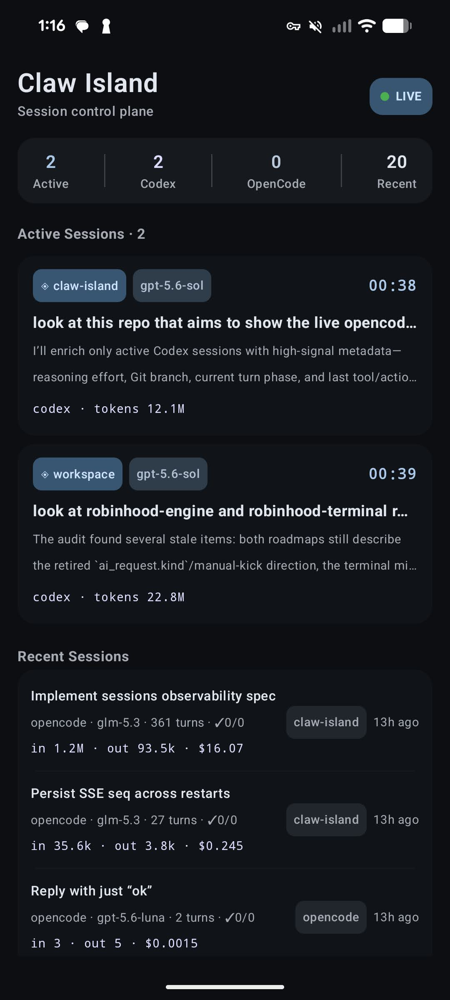
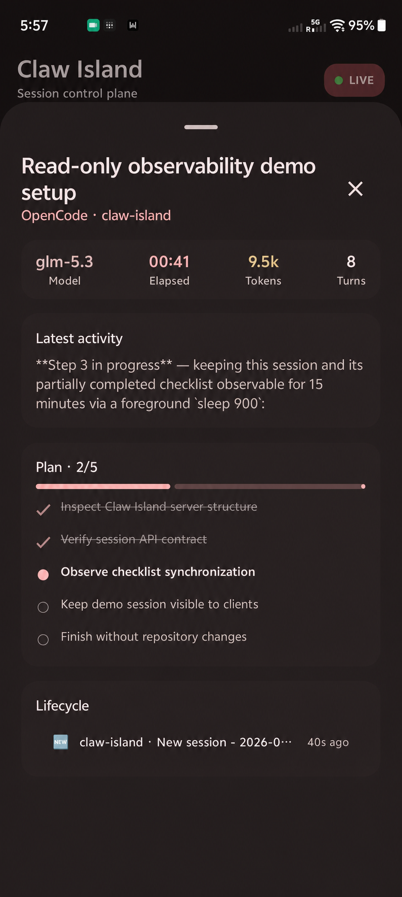
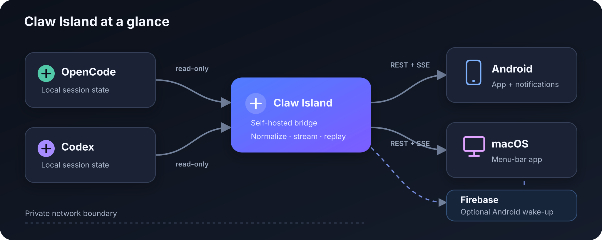

# Claw Island

Claw Island is a self-hosted companion for watching local Codex and OpenCode
sessions away from the terminal. It turns agent activity into a compact live
dashboard: what is running, what changed, how far the current plan has
progressed, and when a session finishes.

It is an observability layer, not an agent gateway. Claw Island reads local
session state and never submits prompts, runs tools, or controls an agent.

<p align="center">
  
  
</p>

## Highlights

- One view for active and recent Codex and OpenCode sessions.
- Live activity, token usage, lifecycle events, and named plan steps.
- Native Android app with ongoing notifications and optional FCM wake-up.
- Native macOS menu-bar app with reconnect and launch-at-login support.
- Runs on your personal network: a workstation, home server, or private VPS.

## Architecture

<p align="center">
  
</p>

The TypeScript bridge runs beside the agent tools and normalizes their local
state into a shared session model. Clients load a snapshot over REST, then
follow updates over Server-Sent Events. A durable event cursor lets clients
recover lifecycle events after reconnecting. On Android, FCM can wake an
offline client; SSE remains the source of detailed live state.

The bridge exposes session titles, repository names, activity, and plan text.
Keep it within a personal VPN such as Tailscale, or place a VPS deployment
behind an authenticated reverse proxy.

## Operations

### Run the bridge

The bridge requires Node.js 22 or newer and access to the Codex or OpenCode
state it observes. Run it on the same workstation, home server, or VPS where
those agent sessions run.

```bash
git clone https://github.com/Cutuy/claw-island.git
cd claw-island
npm ci
npm run build
npm start
```

It listens on port `18818` by default. Set `PORT` to override it. Verify the
deployment with:

```bash
curl http://127.0.0.1:18818/healthz
```

For a persistent Linux deployment, run the bridge as an unprivileged user and
manage it with a user-level systemd service:

```ini
[Unit]
Description=Claw Island bridge
After=network-online.target

[Service]
Type=simple
WorkingDirectory=/path/to/claw-island
ExecStart=/usr/bin/node dist/index.js
Restart=on-failure
Environment=PORT=18818

[Install]
WantedBy=default.target
```

After installing the unit as
`~/.config/systemd/user/claw-island-bridge.service`:

```bash
systemctl --user daemon-reload
systemctl --user enable --now claw-island-bridge.service
journalctl --user -u claw-island-bridge.service -f
```

### Connect clients

Build or install the Android and macOS apps, then set the bridge URL in each
client. The URL must be reachable from the device, for example through your
private Tailscale network.

```bash
# Android
cd android && ./gradlew testDebugUnitTest assembleDebug

# macOS
cd macos && ./scripts/self-test.sh && ./scripts/package-app.sh
```

Android works without Firebase while its foreground service is connected.
For offline delivery, configure a Firebase Android app at build time and give
the bridge a Firebase Admin service-account file through
`FIREBASE_SERVICE_ACCOUNT_FILE`. Keep that file outside the repository and
restrict it to the service account running the bridge.

### Upgrade and verify

```bash
git pull --ff-only
npm ci
npm test
npm run check
npm run build
systemctl --user restart claw-island-bridge.service
curl http://127.0.0.1:18818/healthz
```

Back up the bridge runtime state if lifecycle replay continuity matters. Never
commit `.env`, Firebase service-account keys, `google-services.json`, device
registrations, APKs, or build output.

## Repository

```text
server-ts/              TypeScript bridge
android/                Kotlin/Compose Android client
macos/                  SwiftUI menu-bar client
docs/                   Design records and project plans
server-python-legacy/   Retired bridge retained for reference
```

No open-source license has been selected yet. Add a `LICENSE` file before
publishing or accepting contributions.
