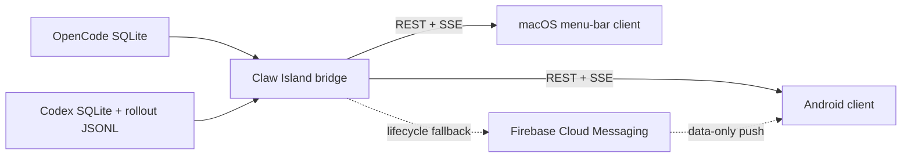

# Claw Island

Claw Island is a small, self-hosted observability bridge and companion UI for
local [OpenCode](https://opencode.ai/) and [Codex](https://openai.com/codex/)
sessions. It exposes active work, recent sessions, lifecycle events, token
usage, and named plan steps to Android and macOS clients.

The project is designed for a trusted private network such as Tailscale. It is
not an agent gateway and does not execute prompts, commands, or tool calls.

## What it provides

- A TypeScript/Fastify bridge with REST and Server-Sent Events (SSE).
- Read-only adapters for local OpenCode and Codex state.
- Durable lifecycle event sequencing and reconnect replay.
- Full named action-plan checklists for active sessions.
- An Android 12+ client with a persistent status notification, Pixel live
  updates, best-effort vivo/OriginOS island integration, and an optional
  Firebase Cloud Messaging fallback.
- A native macOS 14+ SwiftUI menu-bar client with lifecycle notifications,
  sleep/wake recovery, and launch-at-login support.

## Architecture



SSE is the authoritative live transport. The bridge assigns a durable sequence
number to lifecycle events, and clients reconnect with their last sequence to
recover missed events. Android FCM is a compact, best-effort alert path used
for registered devices without an active SSE connection; it is not a second
event ledger.

## Requirements

### Bridge

- Linux or macOS
- Node.js 22 or newer (the Codex adapter uses Node's built-in SQLite API)
- A local OpenCode and/or Codex installation

### Android

- Android Studio or an Android SDK capable of building API 36
- JDK 17
- Android 12 / API 31 or newer
- Google Play services for optional FCM delivery

### macOS

- macOS 14 or newer
- Swift 6 / a current Xcode command-line toolchain

## Quick start

### 1. Run the bridge

```bash
git clone https://github.com/Cutuy/claw-island.git
cd claw-island
npm ci
npm run build
npm start
```

The bridge listens on `0.0.0.0:18818` by default. Override the port with
`PORT`:

```bash
PORT=9000 npm start
```

Default source locations are:

- OpenCode: `~/.local/share/opencode/opencode.db`
- Codex: `${CODEX_HOME:-~/.codex}`

If one source is absent or temporarily unreadable, the other remains
available and the response includes a warning.

### 2. Configure and build Android

The Android client has a development default bridge URL. Open the app's
connection settings and replace it with the URL reachable from your phone.

```bash
cd android
./gradlew testDebugUnitTest assembleDebug
```

The debug APK is written to:

```text
android/app/build/outputs/apk/debug/app-debug.apk
```

Android uses a foreground service for continuous SSE monitoring. Pixel live
updates and vivo/OriginOS island promotion are controlled by each vendor and
OS release; third-party island promotion is therefore best-effort. A normal
ongoing notification remains the fallback.

### 3. Build the macOS menu-bar app

```bash
cd macos
./scripts/self-test.sh
./scripts/package-app.sh
open "dist/Claw Island.app"
```

Open Settings in the menu-bar app and enter the bridge URL. The package script
uses ad-hoc signing for local development; distribution outside your own Mac
requires the normal Apple signing and notarization workflow.

## Optional Android push fallback

Android works without Firebase. With no Firebase configuration, the foreground
service simply relies on SSE and cursor replay.

To enable FCM:

1. Create a Firebase project and register the Android package
   `com.cutuy.clawisland`.
2. Build the app with the identifiers from `google-services.json`:

   ```bash
   export CLAW_FIREBASE_APP_ID='your mobilesdk_app_id'
   export CLAW_FIREBASE_API_KEY='your Android API key'
   export CLAW_FIREBASE_PROJECT_ID='your project_id'
   export CLAW_FIREBASE_SENDER_ID='your project_number'
   export CLAW_PUSH_PAIRING_TOKEN='a shared registration token'
   ./gradlew assembleDebug
   ```

3. Store a Firebase Admin SDK service-account JSON outside the repository and
   point the bridge to it:

   ```bash
   export FIREBASE_SERVICE_ACCOUNT_FILE="$HOME/.config/claw-island/firebase-service-account.json"
   export CLAW_ISLAND_PUSH_PAIRING_TOKEN='the same shared registration token'
   npm start
   ```

`google-services.json` contains app/project identifiers, while the Admin SDK
JSON contains a private key. Both are ignored by this repository, but the
Admin SDK file must be treated as a secret and must never be committed.

The pairing token prevents accidental device registration against a reachable
bridge. Because it is embedded in the Android build, it is not a substitute
for network access control or user authentication.

## API

| Method | Path | Purpose |
| --- | --- | --- |
| `GET` | `/healthz` | Bridge health, push configuration, registered-device count |
| `GET` | `/api/sessions` | Current active and recent session snapshot |
| `GET` | `/api/sessions/events` | SSE snapshots, heartbeats, and lifecycle replay |
| `GET` | `/api/sessions/events/latest` | Recent durable lifecycle events |
| `POST` | `/api/push/devices` | Register an Android FCM token |
| `DELETE` | `/api/push/devices/:deviceId` | Remove an Android registration |
| `GET` | `/api/status` | Legacy single-status compatibility endpoint |
| `GET` | `/api/events` | Legacy SSE compatibility endpoint |

Useful SSE query parameters:

- `after=<sequence>` replays lifecycle events newer than the cursor.
- `device_id=<installation-id>` allows the bridge to avoid FCM delivery while
  that Android device has an active SSE connection.

Full SSE frames contain the current snapshot and named plan items. When
nothing changed, the bridge emits a compact `delta: false` heartbeat; clients
must retain the last full snapshot.

## Security notes

- Run the bridge on a trusted LAN, Tailscale network, or behind an
  authenticated reverse proxy. It binds all interfaces and currently permits
  cross-origin requests.
- Session responses may include repository names, session titles, model names,
  plan steps, and recent activity. Treat the API as private observability data.
- The source adapters are read-only, but they consume internal local database
  formats that may change between OpenCode or Codex versions.
- Never commit `.env`, `google-services.json`, Firebase Admin SDK keys, runtime
  event state, device tokens, APKs, or build output.
- FCM payloads intentionally contain only lifecycle identifiers and short
  display text; detailed plans and activity remain on SSE.

## Development

Bridge checks:

```bash
npm test
npm run check
npm run build
```

Android checks:

```bash
cd android
./gradlew testDebugUnitTest assembleDebug
```

macOS checks:

```bash
cd macos
./scripts/self-test.sh
./scripts/package-app.sh
```

The `server-python-legacy/` directory contains the retired Python bridge for
reference. New server work should target `server-ts/`.

## Repository layout

```text
android/                Kotlin/Compose Android client
macos/                  SwiftUI menu-bar client
server-ts/              TypeScript bridge and tests
server-python-legacy/   Retired Python implementation
docs/                   Architecture notes, completed work, and follow-ups
```

## License

No open-source license has been selected yet. Add a `LICENSE` file before
announcing the repository as open source.
